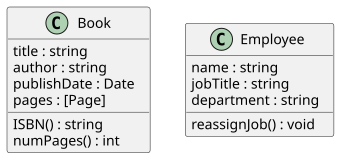
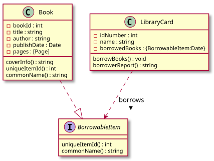
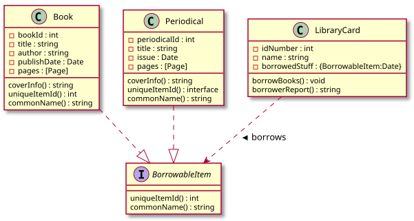

# Object-Oriented Programming Paradigm

## Introduction

As procedural programming became more and more mainstream, computer scientists started to notice the issues behind states and side effects.
Some languages offered a complete paradigm shift, completely abandoning the notion of state.
This exodus formed the alternative paradigm family, declarative paradigm.
Other languages however, went on a different direction.
These languages offered a solution to fixing state by introducing richer features and an intuitive design.
From this approach the paradigm object-oriented programming was born.

As time went by and as technology evolved, computer scientists noticed new issues on the code they were writing.
The goal of building the most optimized machine code became less and less of a priority.
Programmers had, under their disposal, faster and better hardware.
As the demand for complex systems grew, a new standard for code quality emerged. Not only must good code be efficient, good code must also be **maintainable**.

This shift in focus can be seen from the extremes of procedural paradigm such as the programming language Assembly.
Assembly code was not really built to be intuitive.
It was built to work efficiently.
Assembly contained mechanisms to move data around and to control program flow.
These features were enough for that time since the objective of programming was to write efficient code that bulky slow CPUs understand.
Assembly programmers did not have time to worry about code elegance or intuitiveness.

The landscape started to change when hardware started becoming better and software started becoming more complex.
Speed and memory wasn't that much of an issue anymore, that programmers had time to worry about other qualities of code.
Software became bigger, solved more complex problems, and shared across multiple people.
Now, programmers want code to be *easy to understand* and *resilient to change*.
Because of this, writing code that a computer understands isn't enough anymore, a good programmer must write code that humans understand as well.

Instead of redesigning the concept of imperative paradigm to solve maintainability, object-oriented programming sought to build on top of the features of imperative programming.
State despite its known issues, still exists, but OOP gave imperative programmers extra tools to protect code from being carelessly mutated.
Because of this OOP stayed under the imperative family since the programmer is still focused on telling the computer what to do using assignment statements and mutation.

## Fundamental Concepts of OOP

Object-oriented programming is usually defined using its four core design principles:

- Encapsulation
- Abstraction
- Inheritance
- Polymorphism

It is said that any programming language that contains these mechanisms is an object-oriented programming language.
But calling the entirety of a programming language, OOP can be problematic since you are free to write code written in an "OOP language" without actually using these design principles.
At the end of the day OOP is not merely a language classification, but a paradigm.
Some programming languages are indeed intentionally written to be used for OOP design, but these classifications are less important than judging if the code itself written by the programmer adheres to OOP's design principles.

### The Object

Objects are the main focus of OOP.
It is what the paradigm is named after.
You can think of objects as the combination of three abstractions.

- Data abstraction
- Behavior abstraction
- Organizational abstraction

An abstraction in computer science is basically a model of computation that is free from its implementation.
In the same way that functional programming creates abstractions of mathematical functions by writing lambdas without side effects, OOP creates abstractions through its objects.

#### Object abstraction

Objects provide a way to create **abstractions of data**.
Instead of looking at memory addresses, we group together a sequence of memory addresses and give it a more meaningful representation.

| Address        | Stored Byte   |
|--------------  |---------------|
|`0x7FFD53A42B10`|`0x2C`         |
|`0x7FFD53A42B11`|`0x01`         |
|`0x7FFD53A42B12`|`0x00`         |
|`0x7FFD53A42B13`|`0x00`         |

```c
int x = 300;
```

Instead of manipulating 4 bytes spanning `0x7FFD53A42B10-0x7FFD53A42B13`, we group them into an `int`, and display it as the base-10 number `300`.

```c
int coef1 = 3;
char var1 = 'x';
int exp1 = 2;

int coef2 = -2;
char var2 = 'x';
int exp2 = 1;
```

```c
struct Monomial {
    int coefficient;
    char variable;
    int exponent;
};
...
struct Monomial m1 = { .coef = 3, .var = 'x', .exp = 2 }
struct Monomial m2 = { .coef = -2, .var = 'x', .exp = 1 }
```

Instead of holding on to separate variables to represent related group of values, we can declare a struct.

#### Behavior abstraction

Objects also provide abstractions for behavior.

```asm
loop_start:
    cmp eax, 5
    jge loop_end
    ...
    inc eax
    jmp loop_start
```

Instead of using jumps/goto to control which assignment statements are executed, we instead use if/else statements, while-loops, switch-cases, etc.
We also use procedures and functions as abstractions to isolate and reuse multiple structured control flow mechanisms into a distinct behavior.

#### Organizational abstraction

Objects also provide the mechanism to further **organize code**.
Instead, a single global environment shared by the entire system, we subdivide our code and its references into namespaces, libraries, reusable modules, etc.

### The Class

Often discussed alongside an object is the class.
A class contains the specifications for the *creation of objects*.
If you want to give a class a more proactive role, you can think of the class as the *factory* that builds objects.
You can also call objects as **instances** of a class.
For example, the Cash object, `$2.75` is an instance of a Cash object.
Or a cat named Garfield is an instance of a class called Mammal.

If an object is a representation of a tangible real world object, then the class is the conceptual *type*/*category* of that real world object.

The following class diagrams are the representations of a book and an Employee.
The attributes of the book are `title`, `author`, `publishDate`, and `pages`.
These attributes also simulate the form of a real world book.
This object also has methods called `ISBN()` and `numPages()`.
The attributes of an employee are `name`, `string`, and `department`, and it has a method called `reassignJob()`.



The following are representations of objects:

```
book1 {
    title: "Corpus Hermeticum"
    author: "Hermes Trismegistus"
    publishDate: Dec 12, 2008
    pages: ......
}

book2 {
    title: "Behold a Pale Horse"
    author: "Milton William Cooper"
    publishDate: Dec 1, 1991
    pages: ......
}

employee1 {
    name: "Kain Pathos Crow"
    jobTitle: "Senior Researcher"
    department: "Bio-Research Area-12"
}
```

### Data Hiding and the Interface

Before we play around with some code, lets dive deep into the philosophy of object-oriented paradigm.
The philosophy of OOP is the concept called **data hiding**.
This term describes how OOP allows imperative programs to *create boundaries between different parts of data and behavior*.

In the eyes of an OOP design, procedural code is a mix of data and functions arbitrarily mixed together into soup of code.
OOP's mechanism to create boundaries in the form of objects brought structure to imperative programming.
For example, all the attributes of a `Book` object doesn't need to be accessed by the methods of a `LibraryCard` object.
That's because in the real world, a library card doesn't need to know what's written on page 67 of some book.
Some of the data in `Book` should be **hidden** from a client object `LibraryCard`.

Object-oriented programming obsesses over boundaries and organization because it is a necessity for human comprehension and maintainability.
Systems need good structure not because well-structured code is pleasant and elegant to look at, but because our minds can't process poor structure efficiently.

The process of modeling elegant object representations is basically determining what the **public interface** of that object may be.
The interface of an object is the set of attributes and methods that are *exposed* to other objects.
The attributes and methods that are not included in said interface is essentially hidden information, i.e. externally inaccessible.
For example, consider a `Book` object that interacts with a `LibraryCard` object.
The `LibraryCard` object's interface to interact with a book may only contain, `title` and `author`, because this is all the information it needs to properly do its job.
You can even go further and hide the title and author.
You can limit the `LibraryCard` to only interact with the `Book` using a `borrow()` method.
This `borrow()` method may simply record a book's identifier into the library card.
It doesn't need access to the attributes of the book to do this.




#### Abstraction of Objects

Creating interfaces like these provide OOP with the mechanism to create **abstractions**[^abstraction] in the object level.

[^abstraction]: The term abstraction is actually quite overloaded in OOP and CS in general. The "abstraction" I'm talking about in this context is the concept of the abstract interface.

In the previous example, the interface `BorrowableItem` is an abstract representation of *something from the library that can be borrowed*.
An interface like `BorrowableItem` contains method names and type signatures, but it doesn't actually contain code.
That is because a `BorrowableItem` is an abstract representation.
We are not supposed to care about the implementation of the methods `uniqueItemId()` and `commonName()` all we should care about is that `uniqueItemId()` should return some `int` and `commonName()` should return a `string`.

The reason why this structure still works, is because we have a concrete class called `Book` which is a **realization** or an **implementation** of `BorrowableItem`.
A book is *something from the library that can be borrowed*.
Because a `Book` is a `BorrowableItem`, it must also behave based on the specifications of a `BorrowableItem`.
Meaning it must contain the methods `uniqueItemId()` and `commonName()` (which should also have the same type signature as the methods of `BorrowableItems`).
Since `Book` is a concrete class it's methods `uniqueItemId()` and `commonName()` should be implemented (meaning there should be code inside these methods).

Why even go through all this trouble? If *something from the library that can be borrowed* is an abstract idea, what is the point of modelling its representation? This looks like extra code just to represent something that doesn't really have an exact form in the real world.

For the current structure we created, this feels like extra code because our system is small enough right now.
But imagine if our system grows, and we need to incorporate other things from the library that are not books but can be borrowed.
For example, a library also contains periodicals that you can borrow as well, and these periodicals do not follow the form of the book.
You need a different representation for a periodical, therefore you need to create a new concrete class called `Periodical`.
Since a periodical is also *something from the library that can be borrowed*, a periodical is another **realization** of `BorrowableItem`.
And with the tiny effort of writing the implementation of a periodical (including the realized methods `uniqueItemId()` and `commonName()`), we added an extra interaction that allows a `LibraryCard` to borrow periodicals as well.



#### The Interface and the Implementation

Let's summarize what we learned so far by discussing how these capabilities characterize the philosophy of OOP.
The paradigm aims to solve the issues of state and maintainability by allowing programmers to create boundaries between its mix of attributes and methods.
The boundaries you enforce are basically the object structure you create.
A library card name shouldn't mix with a book title, so we put a boundary between them by **encapsulating** them into their respective objects.


Your job as an OOP programmer is to make sure that the complexity of the surface grows slower than the complexity of the core.
This means that as your system evolves, changes that happen in the core i.e. the implementation hidden inside each object, as much as possible, shouldn't affect the surface, the interfaces of each object.
This is what harmony and elegance in OOP means.
Objects interact with each other seamlessly, and intuitively, regardless of what their inside look like.
